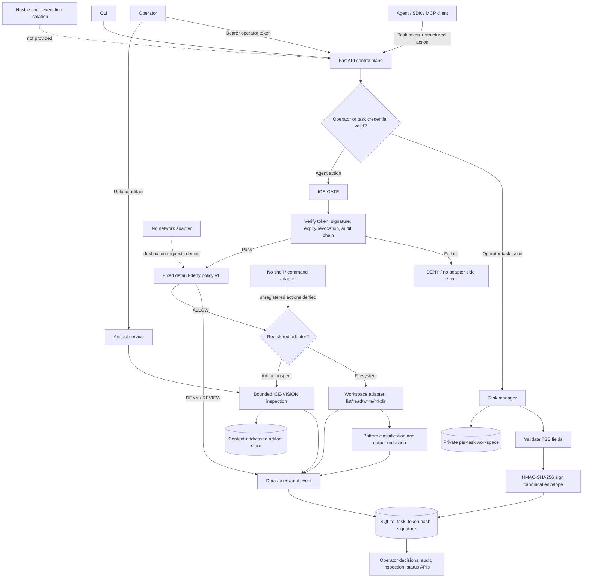

# BLACK ICE architecture

## Scope and implementation status

BLACK ICE is currently a **single-process Python/FastAPI control plane** that mediates a small registry of task-scoped tools. The implemented runtime is a local, default-deny gateway—not a complete autonomous-agent containment platform. It can enforce its rules only for actions that pass through its API/SDK/MCP path. It does not isolate hostile code or protect execution paths that bypass the gateway.

The architecture described here reflects the repository implementation, especially `src/blackice/api/app.py`, `models.py`, `tasks.py`, `crypto.py`, `gate.py`, `policy.py`, `tools.py`, `sandbox/workspace.py`, `artifacts.py`, `vision.py`, `flow.py`, and `database.py`. The broader target in the project prompt includes subsystems that are still absent or partial; they are not implied by the labels below.

| Area | Current implementation | Status / boundary |
|---|---|---|
| ICE-GATE | Authenticates task credential; verifies signed envelope and audit chain; applies policy; invokes only registered adapters; records decisions | Implemented for gateway-mediated registered actions; not a system-wide reference monitor |
| ICE-POLICY | Deterministic rules for identity, active/expiry state, capability, registered tool, filesystem scope, destination denial, a few protected sequences, and approvals | Implemented as fixed version `v1`; no policy-authoring interface or dynamic policy service |
| Task Security Envelope | Pydantic-validated envelope, HMAC-SHA256 signature, task-specific workspace and bearer credential, expiry and revocation | Implemented; only some fields affect runtime checks; see [TSE](tse.md) |
| Workspace adapter | Relative-path filesystem list/read/write/mkdir under a per-task directory, bounded files, no-follow opens | Implemented for adapter-mediated operations; not an OS sandbox or hostile-code boundary |
| ICE-VISION | Deterministic parsers and heuristic comparisons for a bounded format set | Partial inspection; no claim of complete detection or safety clearance |
| ICE-FLOW | Pattern-based secret/email detection, text redaction, basic action summaries | Partial; no complete lineage, dynamic taint tracking, or outbound adapter |
| ICE-TRACE / ICE-CHAIN | Decisions and audit events provide limited task/action/artifact relationships; small deterministic sequence rules | Partial; no general provenance graph or broad sequence analysis |
| ICE-AUDIT | SQLite hash-linked events and verification; action path refuses execution if verification fails | Tamper-evident, not immutable; privileged host access can rewrite the database and recompute hashes |
| ICE-RESPONSE | Operator task revocation; subsequent gate actions denied | Partial; no runtime termination/isolation control or independent response kill switch |
| ICE-SANDBOX | Workspace-scoped file adapter only | No arbitrary command execution, container, VM, resource-isolated process runner, or network sandbox |
| Agent integration | HTTP API, Python task-bound SDK, optional stdio MCP server and CLI | Implemented with limited exposed functions; MCP does not cover operator workflows |

## Components and request path

1. **Operator/API boundary.** `api/app.py` exposes public health endpoints and bearer-protected operator endpoints for task management, approvals, artifact uploads, decision/audit queries, and the synthetic lab. It also exposes task-token-protected agent endpoints for envelope/status/decision reads and action requests. Operator and agent tokens are distinct. The API has a 15 MiB body cap; task action and artifact payloads have additional limits. HTTP authentication is bearer-token comparison, not an identity provider or transport-security system.
2. **Task issuance.** `TaskManager` creates a new random task/workspace ID, constructs a TSE, creates a private workspace, signs the canonical JSON envelope with the operator-configured signing key, and returns a random agent token once. SQLite stores the envelope and signature plus a SHA-256 hash of the agent token (not the token itself). Signing and operator credentials must be configured for protected operations; otherwise the service is restricted and protected runtime operations return unavailable/fail closed.
3. **ICE-GATE.** `GateService.execute` serializes actions per task in this process, checks the task-token hash, verifies the stored HMAC-signed TSE, checks audit-chain integrity, atomically claims from the task action budget, evaluates policy, consumes any exact-action approval, writes an allow decision before a side effect, then calls the registry adapter. Failed adapter execution is recorded. It does not execute arbitrary agent-supplied code.
4. **Policy and adapters.** `PolicyEngine` applies fixed deterministic rules against the signed envelope, prior decisions, and registered operation set. `ToolRegistry` currently registers filesystem operations and—when available—the artifact-inspection operation. The filesystem adapter uses workspace-relative paths, directory file descriptors and no-follow opens. Text reads are bounded and return pattern-redacted content; binary files are directed to the artifact inspector rather than delivered as text.
5. **ICE-VISION and evidence.** Uploaded artifacts are base64-decoded, bounded, hashed, stored under content-addressed paths, inspected, and written to SQLite with an audit event. Workspace artifact inspection uses the same inspector. Results include extracted representations, findings, coverage, limitations, and uncertainty. These are inspection results, not certificates that an artifact is safe.
6. **Persistence and observation.** SQLite stores tasks, approvals, decisions, inspection reports, and an append-only-by-convention event sequence. Audit events are SHA-256 hash-linked to the previous event. The API exposes audit verification, decisions and a graph-like projection from a bounded window of audit events. This is local persistence, not remote or immutable audit storage.

## Mermaid flowchart

## Trust boundaries

- **Agent ↔ control plane:** Agents are untrusted requesters. Task credentials authenticate possession of one task token; the token does not grant permissions beyond the envelope and policy. Agent-provided classification/provenance values are not authority. The action request must match the envelope’s task and agent identity.
- **External artifact/tool content ↔ authority:** Artifact bytes and extracted text are treated as untrusted input. Inspection may detect heuristic indicators, but an artifact cannot issue or modify a TSE, approve an action, or change policy. Inspection does not guarantee detection of malicious or concealed content.
- **API ↔ execution adapter:** Only explicitly registered operations reach an adapter. The current registry has no shell or network execution tool. This boundary covers only calls through BLACK ICE; another process or direct host access is outside it.
- **Workspace ↔ host filesystem:** The adapter constrains paths relative to a generated task workspace and uses no-follow file opens. Permissions are set restrictively on workspace directories. This is an application-level file API boundary, not process isolation: the BLACK ICE process itself can access its configured state and workspace roots.
- **Operator ↔ control plane:** Operator endpoints require a configured bearer token. Task issuance, approval, and revocation are operator operations. The protected agent cannot call those endpoints using its task token. Anyone who obtains the operator token, signing key, or host/database access is outside the protection afforded by those credentials.
- **Audit store ↔ host administrator:** Hash-chain verification detects unauthorized edits that do not also rebuild the chain. SQLite is local and writable by the service/host operator; there is no external witness, append-only storage, hardware key, or immutable-log guarantee.
- **Network and credentials:** TSE network policy is deny-only; no outbound network adapter is registered. Agent task credentials are stored hashed. There is no general host credential inheritance control because no hostile execution environment is implemented.
- **Human approval:** An operator can approve a `REVIEW` action. An approval token is short-lived, one-use, and bound to one task and exact request digest. It does not expand the task envelope or grant a general capability.
- **Delegation:** No delegation tool or delegated credential issuance is registered. Delegation fields exist in the schema but have no operational delegation path.

## Operational constraints

- Locks are process-local (`TaskLockRegistry`). Use a single application worker; multi-process coordination is not implemented. The database uses SQLite transactions for action-budget and approval consumption, but that is not a replacement for distributed locking.
- Artifact parsers are bounded and contents are not executed by the inspector. The code does not launch parsers in an isolated process. Treat parser dependencies and the host process as part of the trusted computing base.
- The control plane, adapter, database, and signing-key use run in the same service boundary. This is not independent enforcement against a compromised host or service process.
- The SDK and MCP client report control-plane unavailability rather than silently switching to direct filesystem, shell, or network access. This is safe behavior in those integration paths, not proof that every agent runner is configured to use them.
- Operator endpoints and the local SQLite database should be deployed only with appropriate host access controls and protected transport when accessed remotely. The application’s bearer tokens do not themselves encrypt traffic.

## Evidence status

The current Python suite was run from the repository on 2026-11-21 with `.venv/bin/pytest -q`: **24 passed, 1 dependency deprecation warning**. Tests exercise selected API, TSE-signing, approval, audit-tampering, redaction, workspace traversal/symlink, artifact parsing, SDK/client, and MCP-construction cases. They do not constitute a penetration test, full hostile-code sandbox test, comprehensive format corpus, or validation of all prompt objectives. See the other docs for detailed status and rule-specific evidence.
